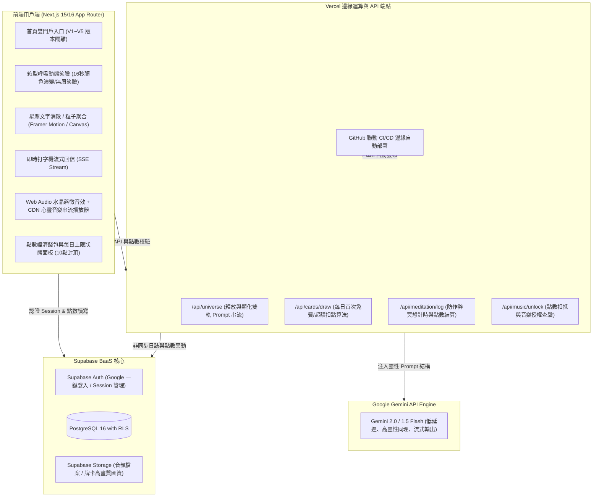
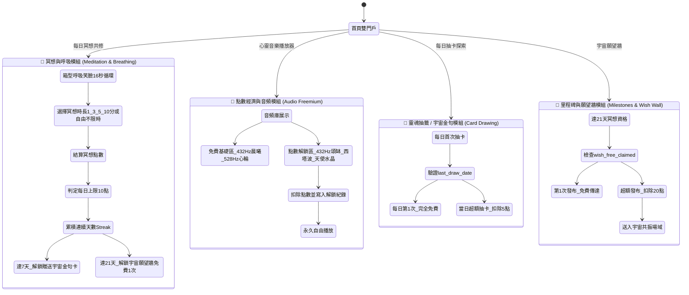

# 《靈魂之境 ‧ 宇宙迴響 (Soul Oracle)》第二版系統完整架構規格書 (Architecture Blueprint V2)

> **專案版本**：v2.0.0 (Master Architecture Blueprint - Second Edition)  
> **生效日期**：2026 年最新修訂版  
> **技術棧**：GitHub + Vercel + Supabase (PostgreSQL 16 / Auth / Storage) + Next.js 15/16 + Google Gemini API  
> **核心定位**：結合箱型呼吸動態笑臉、冥想累積點數、點數經濟、每日免費抽卡（超額扣點）、心事書寫放手釋放、音頻點數解鎖、以及 21 天願望牆免費送一次（超額發布扣點）的現代化全端心靈療癒網頁。

---

## 目錄
1. [系統願景與設計哲學 (第二版升級)](#1-系統願景與設計哲學-第二版升級)
2. [技術架構與選型理由 (BaaS & 點數經濟串聯)](#2-技術架構與選型理由-baas--點數經濟串聯)
3. [核心模組與完整商業邏輯規劃 (四大核心模組)](#3-核心模組與完整商業邏輯規劃-四大核心模組)
4. [完整資料庫綱要與安全策略 (Supabase Schema V2 & RLS)](#4-完整資料庫綱要與安全策略-supabase-schema-v2--rls)
5. [AI 大腦與 Prompt 工程規格 (Gemini AI Engine)](#5-ai-大腦與-prompt-工程規格-gemini-ai-engine)
6. [微體驗、儀式感與 V4 視覺規範 (UX, Motion, Color & Audio)](#6-微體驗儀式感與-v4-視覺規範-ux-motion-color--audio)
7. [專案目錄結構 (Next.js App Router V2)](#7-專案目錄結構-nextjs-app-router-v2)
8. [實作里程碑與推進清單 (Roadmap Checklist V2)](#8-實作里程碑與推進清單-roadmap-checklist-v2)
9. [★ 新舊版本規格全面對比矩陣 (V1 vs V2 Comparison Matrix)](#9--新舊版本規格全面對比矩陣-v1-vs-v2-comparison-matrix)

---

## 1. 系統願景與設計哲學 (第二版升級)

本系統超越傳統「單純占卜」或「冷冰冰日記工具」，打造一個具備**神聖儀式感、心理安全感、神經調節力與點數正向循環**的現代化全端數位心靈庇護所。

### 核心設計哲學：
1. **陰陽平衡雙軌（釋放與顯化）**：
   * **🌙 陰（釋放之門）**：傾訴焦慮、接納脆弱、星塵消散儀式、鬆動固化觀點、提問宇宙。
   * **☀️ 陽（顯化之門）**：焦點創造、願望金種播種、心輪頻率對齊、肯定句注入、接收宇宙祝福。
2. **神聖調頻而非技術等待**：
   * 將 API 等待的 5~8 秒，轉化為「16 秒箱型呼吸微笑光球」與「肯定句默念」，在接收答案前先完成迷走神經放鬆與能量對齊。
3. **心靈點數正向激勵機制 (Soul Gamification & Freemium)**：
   * 以「心靈星光點數」作為能量流動媒介：透過規律冥想、釋放傾訴、肯定句播種賺取點數；並以點數解鎖高品質心靈音樂、超額牌卡探索與深度願望傳達，形成可持續的良性心靈循環。
4. **四方穩固的當下臨在感**：
   * 融入四方神聖能量幾何：吸氣聚光、閉氣凝力、吐氣解縛、閉氣歸空。透過色彩漸層與動態笑臉，給予使用者最深的陪伴感。
5. **絕對隱私與無批判陪伴**：
   * 所有傾訴與願望透過 Supabase Row Level Security (RLS) 隔離，只有本人可讀寫；AI 始終扮演無條件包容的「宇宙智者」。

---

## 2. 技術架構與選型理由 (BaaS & 點數經濟串聯)



### 選型核心優勢：
* **Next.js 15/16 + Tailwind CSS**：極致轉場性能，完美呈現暗夜星空與四方光暈。
* **Supabase (PostgreSQL 16)**：原生 RLS 安全策略，完善支援點數資產、每日免費次數與解鎖紀錄。
* **Google Gemini API**：回覆極具同理心與宇宙哲思，並發成本極低。
* **單一服務埠架構 (Port 3000)**：所有版本 (`/`, `/v2`, `/v3`, `/v4`, `/v5`) 統一在 Port 3000 下運行，避免額外代理造成載入空白。

---

## 3. 核心模組與完整商業邏輯規劃 (四大核心模組)



### 四大核心模組詳細規格：

#### 1. 冥想與基礎呼吸模組 (Meditation & Breathing)
* **免費基礎區**：
  * 畫面中央提供「箱型呼吸動態笑臉」，對應 16 秒循環與色彩漸變（吸氣黃光 ➔ 憋氣漲紅 ➔ 吐氣粉紅光 ➔ 憋氣平靜）。
  * 冥想時的單純呼吸音與 432Hz / 528Hz 水晶磬計時提醒完全免費。
* **冥想點數機制與每日上限 (Earn Points)**：
  * 提供 4 種固定冥想時長選項：
    * **1 分鐘** ➔ 獲得 **1 點**
    * **3 分鐘** ➔ 獲得 **3 點**
    * **5 分鐘** ➔ 獲得 **5 點**
    * **10 分鐘** ➔ 獲得 **10 點**
  * **自由不限時模式**：每滿 1 分鐘獲 1 點，單次結算上限 10 點。
  * **每日點數上限機制 (Daily Cap)**：
    * 每個會員每天透過冥想**最多只能賺取 10 點**。
    * 當日達 10 點後，繼續冥想會正常計算連續天數（Streak）與解鎖徽章，但**不再發放額外冥想點數**。

#### 2. 點數經濟與音頻解鎖模組 (Audio Freemium & Point Redemption)
* **音樂與肯定句音頻區**：
  * **免費區**：提供基礎 432Hz 大地冥想、528Hz 心輪調頻、白噪音或入門肯定句音頻。
  * **點數解鎖區**：絕大多數的高頻率心靈音樂（如 432Hz 頌缽音頻、西塔波深眠、獨角獸天使共振）與肯定句音頻皆需要消耗點數（3~10 點）解鎖後方可播放（記錄於 `user_unlocked_music`，一次解鎖永久播放）。
* **點數取得管道**：
  * 每天乖乖冥想（每日上限 10 點）。
  * 參與心事放手傾訴書寫（每次獲贈 3 點）。
  * 參與願望播種與肯定句接收（每次獲贈 2 點）。

#### 3. 靈魂抽籤 / 宇宙金句模組 (Card Drawing)
* **每日免費 1 次**：每天第一次抽卡完全免費（透過 `profiles.last_draw_date` 判斷是否為今日首抽）。
* **超額抽卡扣點數**：若當天想多次抽卡或進行更多牌卡深度探索，每次需扣除固定點數（預設 5 點）。

#### 4. 里程碑解鎖與宇宙願望牆 (Milestones & Wish Wall)
* **連續 7 天冥想**：
  * 系統自動計算 Streak，達標後自動解鎖並贈送一張「宇宙告訴你的一句話（深度金句卡）」。
* **連續 21 天冥想**：
  * 免費贈送 1 次將願望傳達至「宇宙允許願望牆」的機會（標記 `wish_free_claimed = true`）。
* **超額願望傳達**：
  * 若 21 天的免費額度已使用完畢，之後若想再發布新願望或頻繁將心願送上宇宙共振，則需要消耗指定點數（每次 20 點）解鎖發布權限。

---

## 4. 完整資料庫綱要與安全策略 (Supabase Schema V2 & RLS)

以下為可直接在 Supabase SQL Editor 執行的完整 PostgreSQL DDL 腳本：

```sql
-- ==============================================================================
-- 1. 會員個人資料與點數資產表 (profiles)
-- ==============================================================================
CREATE TABLE IF NOT EXISTS public.profiles (
  id UUID REFERENCES auth.users ON DELETE CASCADE PRIMARY KEY,
  email TEXT,
  nickname TEXT DEFAULT '尋光旅人',
  avatar_url TEXT,
  points INTEGER DEFAULT 0 CHECK (points >= 0),            -- 累積的心靈星光點數
  last_draw_date DATE DEFAULT NULL,                        -- 每日免費抽卡記錄日期
  daily_meditation_points_date DATE DEFAULT CURRENT_DATE,  -- 每日冥想上限重置判定日期
  daily_meditation_points_earned INTEGER DEFAULT 0,        -- 當日已賺取的冥想點數 (每日上限 10 點)
  wish_free_claimed BOOLEAN DEFAULT FALSE,                 -- 連續 21 天達成後的免費許願額度是否已領用
  created_at TIMESTAMPTZ DEFAULT NOW(),
  updated_at TIMESTAMPTZ DEFAULT NOW()
);

-- 自動同步 auth.users 建立 profiles
CREATE OR REPLACE FUNCTION public.handle_new_user()
RETURNS TRIGGER AS $$
BEGIN
  INSERT INTO public.profiles (id, email, nickname, points, daily_meditation_points_date, daily_meditation_points_earned, wish_free_claimed)
  VALUES (new.id, new.email, COALESCE(new.raw_user_meta_data->>'full_name', '尋光旅人'), 0, CURRENT_DATE, 0, FALSE)
  ON CONFLICT (id) DO NOTHING;
  RETURN NEW;
END;
$$ LANGUAGE plpgsql SECURITY DEFINER;

DROP TRIGGER IF EXISTS on_auth_user_created ON auth.users;
CREATE TRIGGER on_auth_user_created
  AFTER INSERT ON auth.users
  FOR EACH ROW EXECUTE PROCEDURE public.handle_new_user();

-- ==============================================================================
-- 2. 每日冥想與點數紀錄表 (meditation_logs)
-- ==============================================================================
CREATE TABLE IF NOT EXISTS public.meditation_logs (
  id UUID DEFAULT gen_random_uuid() PRIMARY KEY,
  user_id UUID REFERENCES public.profiles(id) ON DELETE CASCADE NOT NULL,
  duration_minutes INTEGER NOT NULL CHECK (duration_minutes IN (1, 3, 5, 10)),
  points_earned INTEGER DEFAULT 0 CHECK (points_earned >= 0 AND points_earned <= 10),
  meditation_date DATE DEFAULT CURRENT_DATE NOT NULL,
  created_at TIMESTAMPTZ DEFAULT NOW()
);

CREATE INDEX IF NOT EXISTS idx_meditation_logs_user_date ON public.meditation_logs(user_id, meditation_date);

-- ==============================================================================
-- 3. 成就與里程碑表 (badges)
-- ==============================================================================
CREATE TABLE IF NOT EXISTS public.badges (
  id UUID DEFAULT gen_random_uuid() PRIMARY KEY,
  user_id UUID REFERENCES public.profiles(id) ON DELETE CASCADE NOT NULL,
  badge_type TEXT NOT NULL CHECK (badge_type IN ('7_days_quote', '21_days_wish')),
  reward_quote TEXT,                                       -- 獲得的金句內容 (針對 7天金句卡)
  unlocked_at TIMESTAMPTZ DEFAULT NOW(),
  UNIQUE(user_id, badge_type)
);

-- ==============================================================================
-- 4. 宇宙允許願望牆 (wish_wall)
-- ==============================================================================
CREATE TABLE IF NOT EXISTS public.wish_wall (
  id UUID DEFAULT gen_random_uuid() PRIMARY KEY,
  user_id UUID REFERENCES public.profiles(id) ON DELETE CASCADE NOT NULL,
  author_nickname TEXT DEFAULT '星光旅人',
  wish_content TEXT NOT NULL,
  is_free_claim BOOLEAN DEFAULT FALSE,                     -- 是否為 21 天里程碑贈送的免費額度
  points_cost INTEGER DEFAULT 0 CHECK (points_cost >= 0),  -- 本次發布消耗點數 (免費為 0，超額為 20)
  is_public BOOLEAN DEFAULT TRUE,
  likes_count INTEGER DEFAULT 0,
  created_at TIMESTAMPTZ DEFAULT NOW()
);

-- ==============================================================================
-- 5. 心靈音樂與肯定句音頻庫 (music_tracks)
-- ==============================================================================
CREATE TABLE IF NOT EXISTS public.music_tracks (
  id UUID DEFAULT gen_random_uuid() PRIMARY KEY,
  title TEXT NOT NULL,
  description TEXT,
  duration_label TEXT DEFAULT '15:00',
  audio_url TEXT NOT NULL,
  price_points INTEGER DEFAULT 0 CHECK (price_points >= 0), -- 0=免費，>0=點數解鎖
  category TEXT DEFAULT 'meditation',                       -- free_ambient, singing_bowl_432, affirmation, deep_sleep
  is_active BOOLEAN DEFAULT TRUE,
  created_at TIMESTAMPTZ DEFAULT NOW()
);

-- ==============================================================================
-- 6. 使用者已解鎖音樂紀錄表 (user_unlocked_music)
-- ==============================================================================
CREATE TABLE IF NOT EXISTS public.user_unlocked_music (
  id UUID DEFAULT gen_random_uuid() PRIMARY KEY,
  user_id UUID REFERENCES public.profiles(id) ON DELETE CASCADE NOT NULL,
  track_id UUID REFERENCES public.music_tracks(id) ON DELETE CASCADE NOT NULL,
  unlocked_at TIMESTAMPTZ DEFAULT NOW(),
  UNIQUE(user_id, track_id)
);

-- ==============================================================================
-- 7. 每日抽卡歷史與扣點紀錄 (card_draw_logs)
-- ==============================================================================
CREATE TABLE IF NOT EXISTS public.card_draw_logs (
  id UUID DEFAULT gen_random_uuid() PRIMARY KEY,
  user_id UUID REFERENCES public.profiles(id) ON DELETE CASCADE NOT NULL,
  deck_type TEXT NOT NULL,                                 -- release, manifest, unicorn, cosmic_oneliner
  card_id UUID,
  is_free BOOLEAN DEFAULT TRUE,                            -- 當日第一次為 TRUE，超額抽卡為 FALSE
  points_deducted INTEGER DEFAULT 0,                       -- 扣除點數 (0 或 5)
  drawn_at TIMESTAMPTZ DEFAULT NOW()
);

-- ==============================================================================
-- 8. 心事書寫與願望顯化核心表 (Soul Inquiries & Wishes)
-- ==============================================================================
CREATE TABLE IF NOT EXISTS public.soul_inquiries (
  id UUID DEFAULT gen_random_uuid() PRIMARY KEY,
  user_id UUID REFERENCES public.profiles(id) ON DELETE CASCADE NOT NULL,
  mood_tag TEXT,
  journal_text TEXT NOT NULL,
  universe_reply TEXT NOT NULL,
  interaction_points_awarded INTEGER DEFAULT 3,            -- 釋放傾訴獲贈 3 點
  is_transformed BOOLEAN DEFAULT FALSE,
  transformed_at TIMESTAMPTZ,
  transformation_notes TEXT,
  created_at TIMESTAMPTZ DEFAULT NOW()
);

CREATE TABLE IF NOT EXISTS public.soul_wishes (
  id UUID DEFAULT gen_random_uuid() PRIMARY KEY,
  user_id REFERENCES public.profiles(id) ON DELETE CASCADE NOT NULL,
  category TEXT NOT NULL,
  wish_text TEXT NOT NULL,
  universe_blessing TEXT NOT NULL,
  interaction_points_awarded INTEGER DEFAULT 2,            -- 播種顯化獲贈 2 點
  is_manifested BOOLEAN DEFAULT FALSE,
  manifested_at TIMESTAMPTZ,
  gratitude_notes TEXT,
  created_at TIMESTAMPTZ DEFAULT NOW()
);

-- ==============================================================================
-- 9. Row Level Security (RLS) 安全防護政策
-- ==============================================================================
ALTER TABLE public.profiles ENABLE ROW LEVEL SECURITY;
ALTER TABLE public.meditation_logs ENABLE ROW LEVEL SECURITY;
ALTER TABLE public.badges ENABLE ROW LEVEL SECURITY;
ALTER TABLE public.wish_wall ENABLE ROW LEVEL SECURITY;
ALTER TABLE public.music_tracks ENABLE ROW LEVEL SECURITY;
ALTER TABLE public.user_unlocked_music ENABLE ROW LEVEL SECURITY;
ALTER TABLE public.card_draw_logs ENABLE ROW LEVEL SECURITY;
ALTER TABLE public.soul_inquiries ENABLE ROW LEVEL SECURITY;
ALTER TABLE public.soul_wishes ENABLE ROW LEVEL SECURITY;

CREATE POLICY "Users manage own profile" ON public.profiles FOR ALL USING (auth.uid() = id);
CREATE POLICY "Users manage own meditation_logs" ON public.meditation_logs FOR ALL USING (auth.uid() = user_id);
CREATE POLICY "Users manage own badges" ON public.badges FOR ALL USING (auth.uid() = user_id);
CREATE POLICY "Public read wish_wall" ON public.wish_wall FOR SELECT USING (is_public = true);
CREATE POLICY "Users insert wish_wall" ON public.wish_wall FOR INSERT WITH CHECK (auth.uid() = user_id);
CREATE POLICY "Public read music_tracks" ON public.music_tracks FOR SELECT USING (is_active = true);
CREATE POLICY "Users manage unlocked music" ON public.user_unlocked_music FOR ALL USING (auth.uid() = user_id);
CREATE POLICY "Users manage card draws" ON public.card_draw_logs FOR ALL USING (auth.uid() = user_id);
CREATE POLICY "Users manage soul_inquiries" ON public.soul_inquiries FOR ALL USING (auth.uid() = user_id);
CREATE POLICY "Users manage soul_wishes" ON public.soul_wishes FOR ALL USING (auth.uid() = user_id);
```

---

## 5. AI 大腦與 Prompt 工程規格 (Gemini AI Engine)

在 `/api/universe` 端點中，依據使用者選擇的軌道注入對應的 System Instruction。

### 🌙 軌道一：宇宙傾聽者（心事釋放 Prompt）
```text
【角色設定】
你現在是溫柔、充滿包容力、無批判的「宇宙智者 / 內在神性投射鏡」。
當使用者向你傾訴心事、困惑或提問時，請依序提供以下三層結構，控制在 160-220 字以內，語調溫柔、空靈、輕盈：

【結構規範】
1. 🌟【溫柔承接】：無條件同理對方的感受，允許情緒停留，告訴對方「在這裡你完全被接納與理解，你做得很好」。
2. 💫【Access 可能性提問】：給予 1 個以 Access Consciousness 概念為核心的開放式提問（例如：「如果這裡沒有任何需要被修復的事，會是怎樣的輕鬆？」或「這件事裡有什麼是我還沒看見的禮物？」），鬆動大腦的固化牢籠，不給標準答案，只引導能量流動。
3. 🍃【當下微覺察】：給予 1 個極簡、隨時隨地可做的身心動作（例如：「深吸一口氣，將肩膀自然下沉 2 公分」）。
```

### ☀️ 軌道二：宇宙豐盛導師（願望顯化 Prompt）
```text
【角色設定】
你現在是充滿創造力、喜悅與量子可能性的「宇宙豐盛盟友」。
當使用者向你提交願望與渴望時，請依序提供以下三層結構，控制在 160-220 字以內，語調篤定、充滿喜悅與加持感：

【結構規範】
1. ✨【量子慶賀與祝福】：以「這個願望在量子場域已經為你盛開」的堅定視角，給予無保留的信心祝福與能量加持。
2. 🔮【顯化心法提醒】：點出一個關鍵的顯化心態（例如：警惕「我現在缺乏所以才要」的匱乏頻率，轉化為「我已經在喜悅中體驗」；放下對「宇宙必須如何達成」的控制與執念）。
3. 🌱【靈感微行動】：給予 1 個今天就能帶著喜悅去踏出的具體小步伐（Inspired Action），讓願望在物理維度扎根。
```

---

## 6. 微體驗、儀式感與 V4 視覺規範 (UX, Motion, Color & Audio)

### A. V4 首頁與沉浸式殿堂視覺規範
* **首頁橫幅文案**：「每天留一點時間給自己，冥想累積心靈星光」。
* **進入按鈕**：文字精簡為「開始 ➔」。
* **首頁中央光球**：保持 V2 經典安詳閉眼笑臉（保留眼、腮紅、嘴巴，移除眉毛，營造純粹祥和感）。
* **全螢幕沉浸式能量殿堂**：點擊開始後，彈出視窗加大至滿版視野（`max-w-5xl min-h-[92vh]`），以深邃星空藍黑漸層鋪底。
* **神聖能量方框標題**：
  > 「如同四方穩固的能量方框，每一個停留都是對當下的完全臨在。吸氣聚集光芒、閉氣凝聚力量、吐氣釋放緊繃、閉氣回歸空白。」
* **多重跳出與返回選項**：
  * 左上角「回到前頁」膠囊按鈕（帶箭頭）。
  * 右上角「X」圓形關閉按鈕。
  * 底部「暫不冥想，回到前頁」文字連結按鈕。

### B. 16 秒箱型呼吸四階段引導（4個循環一列無圖示）
在 V4 中，四階段引導卡片橫向排列為一列（4 Columns Grid），並移除多餘小圖示，以乾淨文字與光暈狀態引導呼吸：

| 階段名稱 | 秒數 | 視覺顏色演變 | 臉頰腮紅動態 | 能量意象說明 |
| :--- | :--- | :--- | :--- | :--- |
| **吸氣** | 4 秒 | 圓臉化為溫暖**黃光**緩緩膨脹 (`#FDE68A`) | 柔和粉紅色 (`#F472B6`) | 象徵將宇宙的能量與清新空氣吸入體內。 |
| **憋氣** | 4 秒 | 光球維持最大飽滿，臉色漸漸**漲紅** (`#BE123C`) | **越變越紅** (深度玫瑰紅) | 象徵力量在體內安住、匯聚。 |
| **吐氣** | 4 秒 | 光球轉為柔和**粉紅光**慢慢縮小 (`#F472B6`) | 柔和粉紅色 (`#F472B6`) | 象徵將疲憊與壓力溫柔地釋放出去。 |
| **憋氣** | 4 秒 | 光球維持最小、回歸首頁平靜淡金色 | **越變越紅** (能量凝聚) | 安住於空無一物的當下，準備迎接下一個循環。 |

### C. 轉場儀式與音訊架構
1. **星塵文字消散**：傾訴文字化為 40~60 顆光粒向上飄散，象徵卸下心理重擔。
2. **金光種子凝聚**：願望文字向中心收縮成金色光核飛入光球，象徵宇宙接單。
3. **Web Audio + CDN 音頻**：
   * 原生合成 432 Hz（大地接地）、528 Hz（心輪奇蹟）水晶磬聲（開始與結束音效）。
   * 內建心靈音頻串流播放器，支援背景循環播放、點數解鎖防護與音量平滑淡入淡出。

---

## 7. 專案目錄結構 (Next.js App Router V2)

```text
d:/網頁製作/心靈抽卡/
├── ARCHITECTURE.md              <-- V1 原版規格書 (永久保留以供對比)
├── ARCHITECTURE_V2.md           <-- 本第二版規格書 (當前主藍圖)
├── supabase_schema.sql          <-- Supabase 完整可執行 SQL (含點數經濟與RLS)
├── package.json                 <-- Next.js 15/16 + Tailwind + Framer Motion
├── tsconfig.json
│
├── src/
│   ├── app/
│   │   ├── layout.tsx           <-- 全域暗夜星空與字體佈局
│   │   ├── page.tsx             <-- V1 原版純淨殿堂 (http://localhost:3000/)
│   │   ├── v2/page.tsx          <-- V2 會員與點數原型 (http://localhost:3000/v2)
│   │   ├── v3/page.tsx          <-- V3 箱型呼吸與四模組版 (http://localhost:3000/v3)
│   │   ├── v4/page.tsx          <-- V4 冥想點數與四方能量版 (http://localhost:3000/v4)
│   │   ├── v5/page.tsx          <-- V5 能量殿堂升級版 (http://localhost:3000/v5)
│   │   ├── release/page.tsx     <-- 🌙 釋放之門完整流程頁
│   │   ├── manifest/page.tsx    <-- ☀️ 顯化之門完整流程頁
│   │   └── sanctuary/page.tsx   <-- 個人星空信箱 & 宇宙願望牆
│   │
│   ├── components/
│   │   ├── shared/
│   │   │   ├── BoxBreathingSmilingOrb.tsx <-- 16秒箱型呼吸笑臉 (無眉、腮紅漸紅)
│   │   │   ├── SmilingCosmicOrb.tsx       <-- 經典 8秒呼吸心跳光球
│   │   │   ├── CosmicBackground.tsx       <-- 星空流光背景
│   │   │   └── OracleCard.tsx             <-- 3D 翻轉牌卡組件
│   │   ├── meditation/
│   │   │   ├── DailyMeditationModalV4.tsx <-- V4 全螢幕殿堂 (神聖方框、10點封頂)
│   │   │   └── DailyMeditationModal.tsx   <-- 基礎冥想彈窗
│   │   ├── audio/
│   │   │   └── HealingMusicPlayer.tsx     <-- 心靈音樂點數解鎖播放器
│   │   └── wish/
│   │       └── WishWallModal.tsx          <-- 宇宙允許願望牆 (21天免費/超額扣點)
│   │
│   └── lib/
│       ├── storage.ts           <-- 本地與雲端資料存儲 (含點數上限、每日免費抽卡)
│       ├── sound.ts             <-- 432Hz/528Hz 水晶磬合成器
│       ├── gemini.ts            <-- Gemini AI 串流封裝
│       └── presets/
│           ├── cardsData.ts     <-- 50 張精選宇宙牌卡
│           ├── unicornCards.ts  <-- 獨角獸指引卡
│           └── cosmicOneLiners.ts <-- 7天里程碑宇宙金句卡
```

---

## 8. 實作里程碑與推進清單 (Roadmap Checklist V2)

- [x] **階段一：雙門戶純淨殿堂 (V1)**：完成心事釋放、願望顯化、8秒呼吸光球。
- [x] **階段二：會員體系與專屬牌卡 (V2)**：實作 Google 登入、心靈點數基礎、獨角獸牌卡。
- [x] **階段三：箱型呼吸與四大模組 (V3)**：16 秒箱型呼吸、7 天金句、21 天願望牆、音樂播放器。
- [x] **階段四：V4 視覺與點數機制精進 (V4)**：
  - [x] 首頁標語改為「每天留一點時間給自己，冥想累積心靈星光」，按鈕改為「開始 ➔」。
  - [x] 首頁笑臉維持 V2 安詳無眉笑臉；彈窗內採用 V3 箱型呼吸笑臉。
  - [x] 冥想彈窗擴大為滿版沉浸殿堂（`max-w-5xl min-h-[92vh]`）。
  - [x] 融入四方穩固能量方框神聖標題。
  - [x] 4 個循環一列排開無圖示說明卡。
  - [x] 腮紅精細動態：吸氣與吐氣為粉紅，兩次憋氣均越變越紅。
  - [x] 冥想點數機制：1分=1點、3分=3點、5分=5點、10分=10點，每日冥想上限 10 點。
- [x] **階段五：點數經濟與商業商業閉環 (V5 Baseline)**：
  - [x] 每日首次抽卡 100% 免費；當日超額探索扣除 5 點。
  - [x] 連續 7 天贈送宇宙金句卡；連續 21 天贈送 1 次免費願望牆發布。
  - [x] 願望牆超額發布每次扣除 20 點。
  - [x] 高頻音頻點數解鎖（3~10 點）並記錄至 `user_unlocked_music`。
  - [x] 心事傾訴 (+3 點) 與願望肯定句 (+2 點) 互動賺點。
- [ ] **階段六：雲端 Supabase 實體連線與生產發布**：
  - [ ] 於 Supabase 雲端專案執行 `supabase_schema.sql` 建立正式資料庫。
  - [ ] 設定 Google OAuth Client ID 與 Vercel 生產環境變數。

---

## 9. ★ 新舊版本規格全面對比矩陣 (V1 vs V2 Comparison Matrix)

為方便開發者與產品負責人清晰比對，以下列出第一版 (V1) 與第二版 (V2) 的全面對比：

| 比較維度 | 🏛️ 第一版規格 (V1 Architecture) | 🌌 第二版規格 (V2 Architecture) | 演進說明與優勢 |
| :--- | :--- | :--- | :--- |
| **核心定位** | 單純的「心靈書寫釋放」與「願望顯化」雙門戶問答工具。 | **「呼吸調頻 + 點數經濟 + 免費抽卡 + 音頻解鎖 + 21天願望牆」** 的全端心靈生活平台。 | 從單次工具躍升為具備高留存、高回訪與商業閉環的心靈產品。 |
| **呼吸與光球** | 8 秒平靜呼吸心跳光球（吸氣 4 秒 ➔ 微心跳 1 秒 ➔ 呼氣 3 秒）。 | **16 秒神聖箱型呼吸笑臉**（吸氣 4s ➔ 憋氣 4s ➔ 吐氣 4s ➔ 憋氣 4s）。 | 導入正規醫學與冥想界的箱型呼吸法，神經調節更深層。 |
| **光球視覺與腮紅** | 單一金色漸變光球，帶有心跳 Lub-Dub 彈動。 | **色彩漸變與神態演化**：吸氣黃光、憋氣漲紅、吐氣粉紅光、憋氣平靜。腮紅在雙憋氣時加深變紅，無眉毛更顯純粹空靈。 | 視覺即引導，無需盯著倒數計時也能憑顏色感知呼吸節奏。 |
| **冥想時長與計時** | 無獨立冥想計時器，僅在 AI 回信等待時呼吸 8 秒。 | **提供 1/3/5/10 分鐘倒數及自由不限時模式**，搭配 432Hz/528Hz 水晶磬。 | 滿足日常不同時間段的深層冥想需求。 |
| **點數獲取機制** | 無點數機制（純免費使用）。 | **冥想賺點（1分1點、3分3點、5分5點、10分10點），每日冥想上限 10 點**；心事傾訴+3點、願望播種+2點。 | 設立每日 10 點上限，防刷分且激勵使用者每天定時回訪。 |
| **靈魂抽籤 / 牌卡** | 免費隨機抽卡，無次數與消耗概念。 | **每日首次抽卡免費；當日超額探索扣除 5 點**。 | 兼顧免費體驗與點數消耗場景，提升點數價值感。 |
| **音頻與音樂** | 僅前端合成 432Hz/528Hz 磬音，無長音頻播放器。 | **心靈音樂播放器 (Freemium)**：免費白噪音 + 扣點解鎖 432Hz 頌缽/西塔波等深度音頻。 | 提供高品質音頻享受，強化點數經濟循環。 |
| **里程碑與獎勵** | 無連續天數（Streak）統計。 | **連續 7 天贈宇宙金句卡；連續 21 天解鎖宇宙願望牆免費發布 1 次**。 | 借鑒 21 天習慣養成理論，大幅提升使用者黏著度。 |
| **宇宙願望牆** | 僅本機歷史願望紀錄，無公共願望牆。 | **共振願望牆**：21 天免費贈送 1 次；超額發布每次扣 20 點，支援點讚與能量共鳴。 | 打造集體心靈能量場域，形成靈魂同行者社群。 |
| **視覺介面佈局** | 標準彈窗尺寸，文字說明帶小圖示。 | **V4 全螢幕沉浸殿堂 (`max-w-5xl min-h-[92vh]`)**，四方能量方框引言，4 循環一列無圖示排開，多重回到前頁按鈕。 | 去除視覺雜訊，最大化大氣與沉浸專注感。 |
| **資料庫架構** | 基礎 5 張表 (`profiles`, `cards`, `affirmations`, `soul_inquiries`, `soul_wishes`)。 | **擴充為 9 張表**：新增 `meditation_logs`, `badges`, `wish_wall`, `music_tracks`, `user_unlocked_music`, `card_draw_logs` 等。 | 完善支援點數資產、扣點記錄、每日限制與里程碑狀態。 |
| **版本管理模式** | 單一路徑開發，修正容易覆蓋舊版。 | **嚴格版本隔離矩陣**：保留 `/` (V1), `/v2`, `/v3`, `/v4`, `/v5`，全數運行於 Port 3000。 | 確保所有歷史版本完整可用，隨時可回溯與比對。 |

---

**本規格書為第二版正式基準文件，與第一版 (`ARCHITECTURE.md`) 共同存檔於專案根目錄，供後續系統升級與迭代查閱。**
